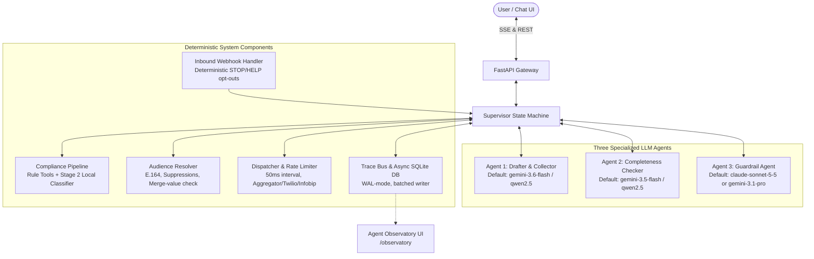

# Architecture Note: Three-Agent CRM Orchestrator (v2)
**Scope:** US-Only, SMS-Only for Non-Profit (Charity events, donation appeals, donation thank-yous) and Political Campaign Outreach & Fundraising.

---

## 1. System Overview & Core Philosophy

The CRM Orchestrator v2 adopts a deterministic state-machine core (**Supervisor**) driving three specialized agents with distinct provider/model identities, combined with deterministic system modules, an asynchronous high-performance trace bus, card-integrated guardrails, and a dedicated **Agent Observatory UI**.



---

## 2. The Three Agents & Model Registry (`models.yaml`)

### Agent Responsibilities & Invariants:
1. **Agent 1 (Drafter & Collector):**
   - Preserves existing conversational behavior: adaptive narrative extraction, one-shot slot capture, no synthetic multiple-choice for open text, 2-step card review + tone tabs.
   - Enforces US Non-Profit / Political scope screening (politely declines out-of-scope requests).
   - Writes extracted facts to the **Claims Ledger** and builds the review card.
   - Generates tone candidate drafts in parallel across: *Urgent & Direct* (only with verified deadline), *Friendly & Casual*, and *Professional & Polite*.
   - Automatically sets `ai_assisted = true` on political outreach/fundraising drafts.
2. **Agent 2 (Completeness Checker):**
   - Never talks to the user directly.
   - Manages the **Instruction Ledger** (tracking discrete user directives across all conversation turns).
   - Executes `check_required_slots` deterministically: validates campaign-specific mandatory slots (Section 3.1).
   - Detects missing/ambiguous context (e.g. contradictory dates, unverified deadlines).
   - Emits a structured `collect_request` to the Supervisor (max 3 rounds).
   - Performs `diff_card_vs_ledger` on the generated review card to verify all captured user instructions appear before the card is shown to the user (max 2 silent fix rounds with Agent 1).
3. **Agent 3 (Guardrail Agent):**
   - Independent model and provider from Agent 1 (e.g., Anthropic Claude Sonnet 5.5 or Gemini 3.1 Pro; never local/weaker fallback). Fails closed if unavailable.
   - Concurrently inspects drafts alongside Rule Tools and the Local Classifier.
   - Strictly enforces the Section 4.4 rubric (neutrality, deceptive urgency, unverified claims, aggressive tone, hidden asks in thank-yous, official impersonation).
   - Flags `failure_origin`:
     - `"draft"`: Triggers silent redraft by Agent 1 (max 2 for harmful, 3 for format/claims).
     - `"user_request"`: Triggers Card Refusal (Section 5.3) with actionable fix suggestions and pre-fill chips.
     - `"none"`: Approved.

### Model Registry Configuration (`config/models.yaml`)
```yaml
agents:
  agent1_drafter:
    provider: "google"
    model: "gemini-3.6-flash"
    temperature: 0.3
    max_tokens: 1024
    timeout_seconds: 30
    fallback:
      provider: "ollama"
      model: "qwen2.5:7b-instruct"
      base_url: "http://localhost:11434/v1"

  agent2_checker:
    provider: "google"
    model: "gemini-3.5-flash"
    temperature: 0.1
    max_tokens: 1024
    timeout_seconds: 30
    fallback:
      provider: "ollama"
      model: "qwen2.5:7b-instruct"
      base_url: "http://localhost:11434/v1"

  guardrail_agent:
    primary:
      provider: "anthropic"
      model: "claude-sonnet-5-5"
      temperature: 0.0
      max_tokens: 2048
      timeout_seconds: 45
    secondary:
      provider: "google"
      model: "gemini-3.1-pro"
      temperature: 0.0
      max_tokens: 2048
      timeout_seconds: 45
    # Strict rule: No local or weaker fallback. Fails closed.
```

---

## 3. Required Slots & Campaign Taxonomy

| Campaign Type | Required Slots (Blocks Drafting) | Optional Slots |
| :--- | :--- | :--- |
| **Common (All)** | `sender_name`, `campaign_type`, `intent_label`, `tone_preference` | `audience_tag` |
| `event` | `event_name`, `event_date_time`, `location`, `rsvp_or_info_link` | `parking_notes`, `accessibility_notes` |
| `donation_appeal` | `cause_purpose`, `donation_link` (registered domain) | `goal_amount`, `impact_figures` (must be in ledger) |
| `donation_thank_you` | `gift_reference_or_amount` (from ledger) | `receipt_link` |
| `political_outreach` | `committee_or_candidate`, `paid_for_by_committee`, `subject`, `source_url` (voting logistics, `.gov` only) | `office_sought` |
| `political_fundraising`| `committee_or_candidate`, `paid_for_by_committee`, `donation_link` (registered domain) | `goal_amount` |

---

## 4. Compliance Tool Contract & Dispatch Table

### Uniform Tool Contract:
```python
class ToolResult(BaseModel):
    tool_id: str
    category: Literal["format", "harmful_intent", "claims", "policy_gate"]
    passed: bool
    reason: str
    offending_span: Optional[str] = None
    severity: Literal["block", "warn"] = "block"
```

### Tool Categories & Execution Pipeline:
1. **Policy Gate (Pre-Draft & Pre-Dispatch; Non-retryable):**
   - `validate_sender_entity`: Verifies `org_registry` record, legal eligibility, use-case match, and sending number ownership.
   - `check_org_type_gate`: 501(c)(3) charities are hard-blocked from political templates.
   - `check_campaign_verify`: Valid Campaign Verify token required for 527 political entities.
   - `check_use_case_match`: Template category must match registered campaign authorization.
   - `check_age_gate_flag`: Alcohol-related charity galas require `age_gated = true`.
   - `check_ai_disclosure`: Enforces state-specific AI declaration line on political outreach.
2. **Rule Tools (Concurrently with Classifier & Guardrail):**
   - `check_sender_identified`: Registered name must appear within the first 80 characters.
   - `check_intent_stated`: Declared intent lexicon phrase present.
   - `check_banned_urls`: Regex + suffix matching against `banned_url_domains` (seeded with `bit.ly`, `tinyurl.com`, `tiny.url`).
   - `check_url_allowlist`: All URL domains match the organization's verified domain list.
   - `check_claims_in_ledger`: Numbers, dates, dollars, percentages must match user-verified claims ledger. Voting logistics require `.gov` source URL.
   - `check_opt_out`: Mandatory STOP opt-out instruction (omitted on `stop_reply`).
   - `check_rates_disclosure`: CTIA rates disclosure on CTA and opt-in confirmations.
   - `check_paid_for_by`: Mandatory "Paid for by {committee}" for political messages.
   - `check_encoding_segments`: GSM-7/UCS-2 analysis and segment ceiling check (replaces old 320-word limit).
   - `check_placeholders`: Detects leaked unrendered tokens (`[Date]`, `{{field}}`).
   - `check_merge_values`: Per-recipient merge evaluation ensuring no injected URLs, phone numbers, or scam spans.
3. **Harmful Intent Classifier & Guardrail Agent:**
   - `classify_message`: Stage 2 Local DistilBERT ($>= 0.95$ safe, $>= 0.90$ harmful, otherwise uncertain).
   - `guardrail_agent`: LLM Rubric checking instruction adherence, tone match, coercive urgency, neutrality, and harmful intent.

---

## 5. Card State Contract & UI Lifecycle

Card states are emitted by the Supervisor and rendered directly in the customer UI:

```typescript
interface CardState {
  card_type: "review" | "tone";
  state: "ready" | "needs_info" | "regenerating" | "refused" | "blocked_policy" | "could_not_comply";
  highlights: string[];               // Field IDs needing attention
  questions: string[];                // Batched missing-info questions
  badges: {
    sender: "pass" | "fail" | "n/a";
    intent: "pass" | "fail" | "n/a";
    links: "pass" | "fail" | "n/a";
    tone: "pass" | "fail" | "n/a";
    claims: "pass" | "fail" | "n/a";
    compliance: "pass" | "fail" | "n/a";
  };
  refusal: {
    headline_variant: "tone" | "message";
    reason: string;
    suggestions: Array<{ label: string; prefill_instruction: string }>;
  } | null;
}
```

- **Step 1 (Review Card):** Displays `needs_info` with highlighted missing slots, or `ready` once Agent 2's `diff_card_vs_ledger` passes.
- **Step 2 (Tone Cards):** Shows compliance badges on `ready`. If user requests prohibited aggression/deception, renders the `refused` card with 2–4 clickable suggestion chips that pre-fill the chat instruction box.

---

## 6. Trace Bus & Component Communication

All communication flows strictly through the deterministic **Supervisor Bus**. No component directly invokes another. Every action emits a structured `TraceEvent`:

```python
class TraceEvent(BaseModel):
    ts: str
    run_id: str
    campaign_id: str
    span_id: str
    parent_span_id: Optional[str]
    component_id: Literal["agent1", "agent2", "guardrail", "supervisor", "compliance", "audience", "dispatcher", "inbound"]
    component_kind: Literal["agent", "system"]
    type: str # agent.start, tool.call, agent.handoff, card.update, etc.
    to_component: Optional[str]
    tool_id: Optional[str]
    tool_args: Optional[Dict[str, Any]]
    tool_result: Optional[Dict[str, Any]]
    model: Optional[str]
    latency_ms: Optional[float]
    tokens_in: Optional[int]
    tokens_out: Optional[int]
    status: Literal["ok", "fail", "retry", "refused", "quarantined", "blocked"]
    summary: str
```

- Stored in SQLite (`trace_events` table) using WAL mode via a batched async queue.
- Phone numbers are automatically masked (last 4 digits only).
- Streamed in real-time to the Observatory over SSE.

---

## 7. UI Separation & Observatory Plan

### Customer Chat UI (`/`):
- Stripped of all log tabs, pipeline timelines, memory inspect panels, raw debug modals, and webhook setup drawers.
- Dedicated to the clean customer workflow: Chat Input, Review Card, Tone Tabs, Version History & Rollback, Contact Ingestion, and Final Dispatch Confirmation.

### Agent Observatory UI (`/observatory`):
- Completely separate administrative route and SSE stream.
- **Color Coded Swimlanes:** Agent 1 (Blue `#2563EB`), Agent 2 (Violet `#7C3AED`), Guardrail (Amber `#D97706`), Supervisor (Slate `#64748B`), Compliance (Teal `#0D9488`), Audience (Olive `#65A30D`), Dispatcher (Pink `#DB2777`), Inbound (Orange `#EA580C`).
- **Panels:** Live Timeline Swimlane, Component Roster, Handoff Graph, Tool Inspector, Run Replay, Quarantine & Refusal Queues, Banned-URL Manager (CRUD), and Config Inspector.
